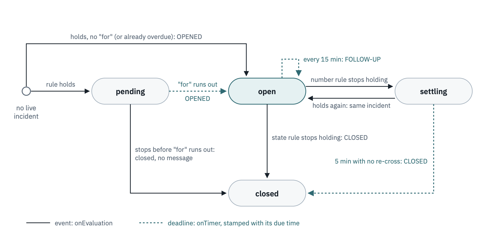
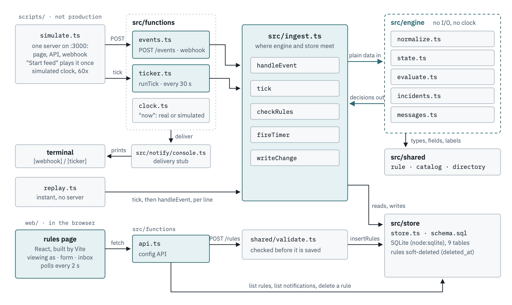

# Assembled Notification HQ

Team leads and agents write notification rules ("billing breaches SLA", "agent is on a call for 45 minutes").

The system checks those rules against a live stream of queue and agent events, then notifies the user once when an incident starts, every 15 minutes while it lasts, and once when it ends.

## Run it

Needs Node 24.15 or newer. The database (`node:sqlite`) and the TypeScript runner are both built into Node.

```
npm install
npm run simulate   # open http://localhost:3000, add rules, click "Start feed"; Ctrl-C to stop
npm run replay     # the seeded rules over the feed in one go, printing every notification
npm test
```

`npm run simulate` builds the page, then serves it with the API and the events webhook on port 3000. Add rules then click **Start feed**. Notifications appear on the page for whoever you are "viewing as".

To fill the form from a sentence, put `OPENAI_API_KEY` and `OPENAI_MODEL` in `.env` (see "Writing a rule in a sentence"). Without them the sentence box shows but is switched off, and everything else works.

`npm run replay` runs the 15 seeded rules over `data/events.jsonl` with no server and no waiting. It prints 33 notifications and the incidents still live at 10:30.

## Audience

Primarily team leads, but agents as a second audience.

These are five working scenarios I used to develop the notifications system based on the sample feed:

| Scenario                                   | Who hears                | On the sample feed                                                |
| ------------------------------------------ | ------------------------ | ----------------------------------------------------------------- |
| A queue has breached SLA                   | lead                     | billing at 09:30, tier_2 at 10:00                                 |
| A queue is near SLA (80 to 100% of target) | lead                     | tier_2 at 09:45, billing at 10:16                                 |
| More than 20 tickets waiting               | lead                     | billing at 09:36, once                                            |
| Out of adherence for 10 minutes            | the agent and their lead | `a_19`, `a_88`, `a_23`                                            |
| On one call for 45 minutes                 | lead                     | `a_11`, `a_07`, `a_31` (and `a_42` at 10:33, after the feed ends) |

## Rules

Stored as data (what the rule watches, the conditions that must all hold, and duration of holding):

```json
{
  "owner_id": "lead_1",
  "subject": { "kind": "team", "resource_ids": ["team_1"] },
  "conditions": [{ "field": "state", "op": "=", "value": "on_call" }],
  "for_seconds": 2700
}
```

- The owner (`owner_id`) of the rule gets the notification when the rule is triggered.
- The subject (`subject`) describes the resource being watched (queues, agents, or agents in a team). There is a constructed roster that enables teams.
- **Conditions test fields from a catalog** (`src/shared/catalog.ts`). Queue fields: `sla_pct`, `tickets_waiting`, `longest_wait_sec`. Agent fields: `state`, `in_violation`. A new thing to alert on is one catalog entry; the engine, the form and the validator all pick it up. A comparison between two raw numbers is one derived field (`sla_pct` is longest wait as a percentage of the SLA target), so rules never need arithmetic.
- **"For N minutes"** is `for_seconds`. It counts from the feed's own start time when there is one (the time of the state change, `violation_started_at`). Otherwise it counts from the first event that showed the condition true.
- **"Whenever X happens"** needs no special case: `state is on_break` with no "for" fires when an agent goes on break.

Every rule is validated before it is saved (`src/shared/validate.ts`).

**Writing a rule in a sentence.** Above the form, a lead or agent can type what they want ("ping me if any of my agents is on a call for 45 minutes"). The assistant (`src/assistant/assistant.ts`) sends the sentence, the field catalog, the directory and who is asking to OpenAI, and asks for strict JSON in the rule's shape.

- The answer goes through the same `validateRule`.
- The owner is always the person asking.
- It only fills the form: nothing is saved until the person checks it and clicks Save.
- If the sentence asks for something a rule can't say ("three of my agents on break at once"), the model gives a reason instead of a rule.
- The model is never involved in evaluating events.

**Rule Limitations.** These were left out on purpose, as each one adds a concept rather than a field:

- Two subjects in one rule ("billing breaching while `a_19` is on break").
- Counts ("three of my agents on break at once").
- Trends ("rising for three snapshots").
- "Any queue", which has no representation yet.

Or-conditions are covered by `in` (`state in on_break, in_meeting`) or by two rules.

## Staying quiet

Notifying on every match of a rule would generate a lot of noise (notifications every ~30s).

To address this, I made the primary unit an **incident** (one rule being true for one queue or agent).

1. **Opened**: once, when the rule becomes true (after its "for").
2. **Follow-up**: every 15 minutes while it stays true, carrying the change. For example: "still true after 30 min: SLA used 225% (was 108.3%)". I chose this over "only when it gets worse" because "worse" needs a step size per field and means nothing for a state.
3. **Closed**: once, when it ends. Once follow-ups exist, silence is ambiguous, so the end is said out loud.

The two kinds of rule close differently:

- **A rule on a number must stay false for 5 minutes before it closes.** A wait time hovering at the threshold doesn't open and close the incident every snapshot. Coming back inside those 5 minutes is the same incident.
- **A rule on a state closes on the event.** A call ending, or an agent back in adherence, is definitive.

## How it works

```
feed ──POST /events──▶ events webhook ─┐
                                       ├─▶ ingest.ts ──▶ engine ──▶ store (SQLite)
scheduler ─every 30s─▶ ticker ─────────┘                                     │
                                                                             ▼
page ──────────────▶ config API ─────────────────────── rules, notifications ┘
```

Three deployed functions, all in `src/functions/`:

- **Events webhook** (`events.ts`, `POST /events`) handles one feed event per request, and is the only path that changes state:
  - parse and check the event, and drop a duplicate id;
  - set aside a late event (older than what that queue or agent already has);
  - update the queue's or agent's current state;
  - check every rule that covers it.

  The incident change and its notifications are written in one transaction, so they can't drift apart.

- **Ticker** (`ticker.ts`, every 30 seconds). Fires deadlines that came due with no event: an opening once a "for" runs out, a follow-up, a close after settling. Without it, a quiet feed would leave incidents silent. `a_07`'s call crosses 45 minutes at 10:10, and no event for `a_07` arrives until 10:15.
- **Config API** (`api.ts`). Create, list and delete rules; list a person's notifications; the directory and catalog the form is built from; draft a rule from a sentence (`POST /rules/draft`, which saves nothing).

The engine (`src/engine/`) does no I/O and never reads the clock. "Now" is passed in. That makes every run deterministic and lets the tests assert exact times. The sample feed is dated 2026-05-26, so the scripts pass a simulated clock; production would pass the real one.

**Time.** The clock only moves forward. A deadline fired by the ticker is stamped with its due time, even if the tick runs up to 30 seconds late. If an event for that incident arrives before the tick does, the webhook settles the overdue deadline first, inside the same transaction, against the state before the event. So an agent who comes back into adherence one second after their 10 minutes still gets the opening, and a follow-up reports the numbers from when it was due.

**Dirty data.** This is what the sample feed actually contains, and how each case is handled:

- A duplicate `event_id` is dropped.
- A late event is stored but changes nothing: arrival order isn't time order, and a reorder buffer would delay every notification to fix a rare case.
- A missing `queue_ids` becomes an empty list.
- A first state change has no previous state.
- A reported duration (`a_31`'s call) disagrees with the timestamps. Durations come from timestamps, never from `previous_state_duration_sec`.
- An adherence check reports `in_meeting` for `a_23`, who was last seen `on_call`. The check corrects the state, starting from the check's time.

**Tables** (`src/store/schema.sql`):

| Table                        | Holds                                                                                                                                   |
| ---------------------------- | --------------------------------------------------------------------------------------------------------------------------------------- |
| `events`                     | Every accepted event with its outcome (applied or late). The primary key is the dedupe                                                  |
| `queue_state`, `agent_state` | One row per queue or agent: current values, since when, newest event time                                                               |
| `rules`                      | Owner, subject and conditions (JSON, always read whole), `for_seconds`, `deleted_at`                                                    |
| `incidents`                  | Rule, subject, status (pending, open, settling, closed), and `next_due_at`, which the ticker reads through an index                     |
| `notifications`              | Recipient, kind, time, message, and the subject's state when sent. Unique per incident, kind and sequence, so a retry can't double-send |
| `queues`, `teams`, `users`   | The seeded directory                                                                                                                    |

**Deleting a rule** keeps its row (`deleted_at`) because its incidents and notifications point at it. Its live incidents close in the same transaction, with no message: the owner deleted it themselves.




## At thousands of customers and millions of events a day

1M events/day is ~12 events/sec, so the difficulty here is keeping order/timers correct across many machines (rather than raw throughput).

I didn't build any of this since it's not feasible for a demo, but the current design can be extended in this direction:

- Partition by customer to handle multi-tenancy/scale
  - Can even partition the stream by subject for a large customer
- The ticker/webhook would need to be updated to work with a distributed database
- Rule lookup can also be optimized - every event reads all rules and filters them in code; this could become an in-memory map from subject to rules (rebuilt when a rule is created or deleted).
- Notifications are currently just rows written in the incident's transaction; a notifications worker would handle guaranteed sending.
- A reconciler can be added to handle late events on a schedule and report incidents the live path missed (this was a tradeoff I accepted)
- **SQLite to Postgres.** The SQL is plain, and everything SQLite-specific is in `src/store/store.ts`.

## Code and tests

| Path             | Content                                                                                                               |
| ---------------- | --------------------------------------------------------------------------------------------------------------------- |
| `src/shared/`    | The `Rule` type, the field catalog, the directory shape, `validateRule`                                               |
| `src/engine/`    | Pure logic: normalise an event, apply it to state, evaluate a rule, step an incident's lifecycle, word its messages   |
| `src/store/`     | `schema.sql` and every SQLite read and write                                                                          |
| `src/ingest.ts`  | `handleEvent` and `tick`: the only place the engine and the store meet                                                |
| `src/functions/` | The three deployed functions                                                                                          |
| `src/assistant/` | Sentence to draft rule (OpenAI Responses API, plain `fetch`), checked by `validateRule`                               |
| `scripts/`       | `replay.ts` and `simulate.ts` run the sample feed; `assistant-check.ts` checks real translations. Not production code |
| `web/`           | The rules page (React, built by Vite), typed from `src/shared/`                                                       |

Test cases (`npm test`, 145 tests):

- **The whole sample feed against a table worked out by hand.** `SAMPLE_EXPECTED` in `tests/testHelpers.ts` lists the 33 notifications the seeded rules should send: time, kind, recipient, subject, rule. It was derived from the feed before the engine was written, not captured from output. The replay and the simulation must both match it row for row.
- **A rule created through the API fires on the feed.** "Any of my agents goes on break", posted to `POST /rules`, sends exactly the four notifications worked out beforehand (09:35 opened, 09:50 and 10:05 follow-ups, 10:10 closed).
- **The engine with plain objects and exact times:** "for", follow-ups, settle, re-crossing, the clock never moving backward, and late and duplicate events.
- **The assistant with canned model answers:** the owner is whoever asked, an unknown queue is refused, and so are refusals, API errors and broken JSON. It is switched off without a key, and drafting saves nothing. How well a real model translates is a separate check, `node scripts/assistant-check.ts`. It sends 7 fixed sentences, including the three from the prompt and one a rule can't express, and compares each answer with the expected rule. It needs a key and isn't deterministic, so it isn't in `npm test`; it passed 7 of 7 on two runs.
- **The dirt in the feed, using the real lines** (`feedLine(68)`) rather than retyped copies.
- **The tests were checked by breaking the code on purpose.** Each sprint I made deliberate breaks in a scratch copy, about 40 in all. Examples: the timer firing after the event instead of before; settle applied to state rules; "my team" covering everyone; delete leaving incidents live. Each one failed the suite. Where one didn't, I added the missing test.

## Tradeoffs and what I'd do next

Known limits of what's built:

- **Durations in messages count from the opening, not from when the condition started.** `a_11`'s 70-minute call closes with "no longer true after 25 min".
- **A rule added mid-run applies from its subject's next event.** Nothing is back-filled.
- **No stale-data guard.** If a feed goes quiet, the engine assumes nothing changed.
- **The page polls every 2 seconds.** A real inbox would push.
- **One process.** Several instances need the row claiming described above.
- **Rules made on the page last for one run of the simulation.** The database is in memory, so each run starts clean.

Next, in order:

1. **A head-of-support digest.**
2. **Acknowledge** (stop follow-ups for one incident), **snooze** and **quiet hours**.
3. **Preview before save:** "this rule would have opened 2 incidents this morning". The engine is deterministic, so this is a replay.

Left out on purpose: real delivery, login and multi-tenancy (out of scope per the prompt); editing a rule (delete and recreate).

## How I used AI

I made every design choice for the notification system before starting implementation, and made some follow-up adjustments (e.g. migration to two service simulation) while implementing.

- I used **Claude Code** to write the web app and a majority of the infrastructure around the notifications engine (clock, simulation/ingestion, tests, docs).
- I used **Codex** as a second reviewer (for some design decisions and after Claude Code implemented features). It also built one set of approved fixes (back-to-back calls, and conditions with an unknown start).

Guardrails:

- Every choice for the system was frozen in a decision ledger, and I signed it off before anything was built: audience, rule model, noise policy, time model, stack, modules, schema. AI assistants were not allowed to pick one and start.
- The 33-row table and the break-rule rows were derived from my EDA of the feed before writing any code, so the tests can't simply agree with whatever the code does.

More on the overrulings I had to make in the follow-up adjustments:

- **Queue ownership.** It framed "who owns each queue" as a decision. There is no such thing: whoever writes a rule is told.
- **The rule shape.** It modelled the rule as `subject` plus `scope` ("me", "my team"). Those were two fields that could contradict each other, and UI words stored as data. I replaced them with one `subject: { kind, resource_ids }`.
- **An unconfirmed choice.** It built the webhook to fire every due timer, taking an answer I had sent back for clarification as approval. That was reverted; we settled on the narrower rule described under "Time".
- **The Start button.** It proposed disabling the button "while a run is going". A run never ends, because the ticker carries on. The button now starts the feed once.
